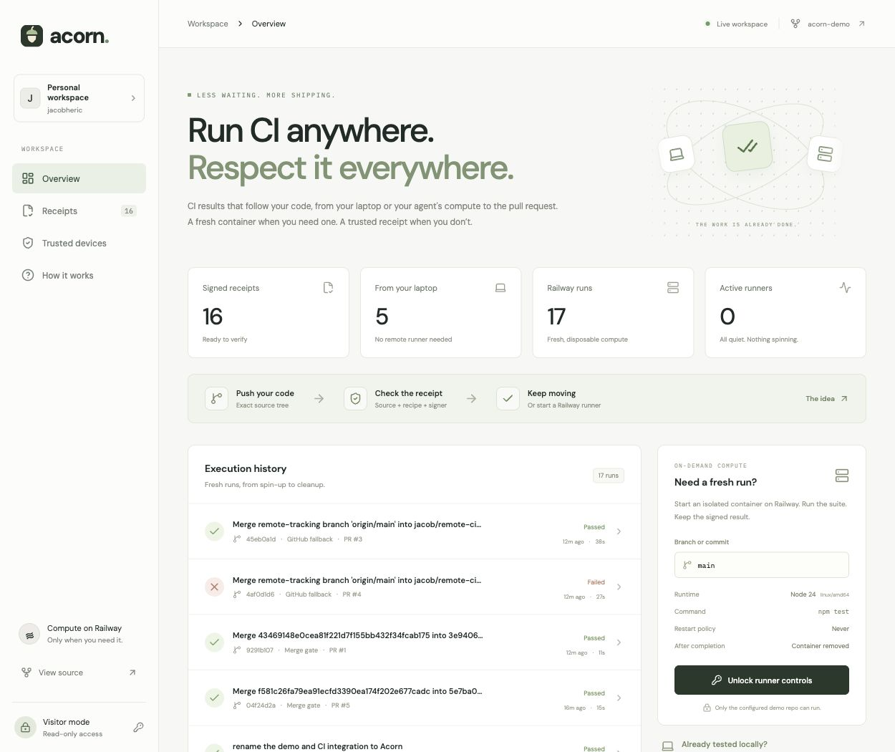
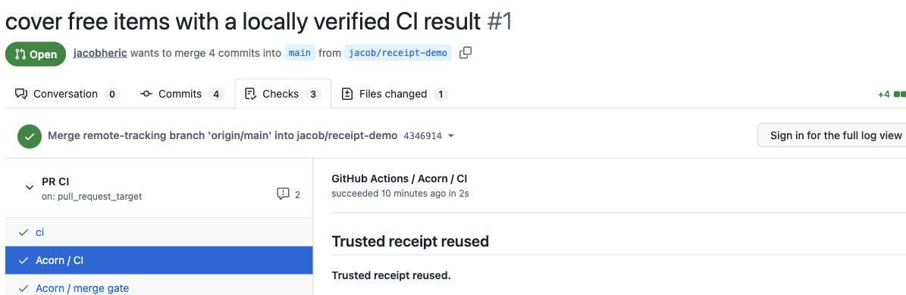

# Acorn

Assert CI anywhere. Respect it everywhere.

CI gets expensive when every push repeats work that already passed. Acorn lets trusted laptops and agents share that work, with signed receipts that follow the code. Local CI is optional; Railway runs it when you need remote compute.

[Live dashboard](https://acorn-production-f406.up.railway.app) · [Demo repo](https://github.com/jacobheric/acorn-demo) · [Setup guide](docs/setup.md)



## How it works

1. **Run anywhere.** Optionally test your committed code locally and publish a signed receipt before pushing.
2. **Push normally.** A GitHub Actions workflow checks for a matching receipt. Without one, Acorn starts a Railway container through its GraphQL API, runs CI, and removes it.
3. **Keep the latest run.** New pushes cancel obsolete CI for the same PR.
4. **Check before merging.** Choose **Enable auto-merge** on the PR. Acorn runs fresh CI against the proposed merge, then GitHub merges when all requirements pass. This extra check is on by default and can be disabled.

## See it in a PR

> 
>
> The PR reuses a trusted receipt. A fresh CI run still checks the proposed merge.

[Receipt reuse and merge gate](https://github.com/jacobheric/acorn-demo/pull/1) · [Remote CI passes](https://github.com/jacobheric/acorn-demo/pull/3) · [Remote CI catches a bug](https://github.com/jacobheric/acorn-demo/pull/4)

The dashboard is public. With an operator token, you can also spin runners up and down. All displayed results come from real runs.

## Run locally

Requires Node 24+, npm, and Git. Local CI also needs Docker.

```sh
git clone https://github.com/jacobheric/acorn
cd acorn
npm ci
node scripts/setup.mjs
npm run build
npm start
```

Open [localhost:3000](http://localhost:3000). Setup creates a private, ignored `.env`. Remote runners need [Railway configuration](docs/setup.md#railway).

## Run CI before pushing

Commit your changes, run the suite with `npm run acorn -- run --repo ../acorn-demo`, then publish the receipt before pushing. See the [device setup and commands](docs/setup.md#run-ci-before-pushing).

## The trust boundary

Acorn accepts a receipt when it comes from a trusted signer and matches the repository, source files, and CI recipe. It still applies if you amend a commit message, but not if you change a tracked file. Receipts expire after seven days, and you can revoke signer keys at any time.

We still trust the signer to have actually run CI. The automatic pre-merge run gives us an independent check, even when the PR already has a receipt. See the [setup guide](docs/setup.md#github) to configure it or opt out.

## Inside

React dashboard, Hono server, SQLite, and disposable Railway containers. Start with the [coordinator](src/server/coordinator.ts), [Railway adapter](src/server/railway.ts), [GitHub action](action/), or [CLI](cli/). The compute provider can be swapped without changing receipt verification.

Run `npm run ci` for type checks, tests, and the production build.
